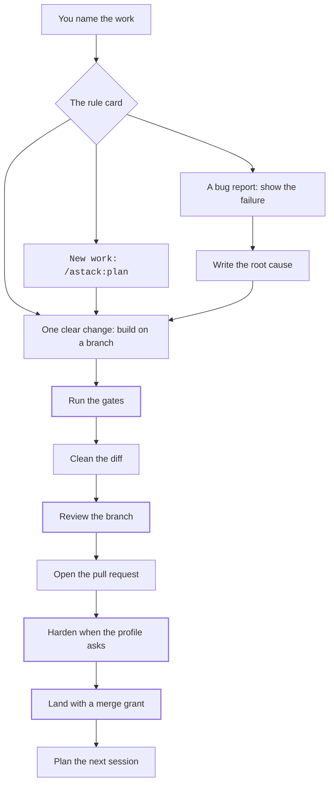
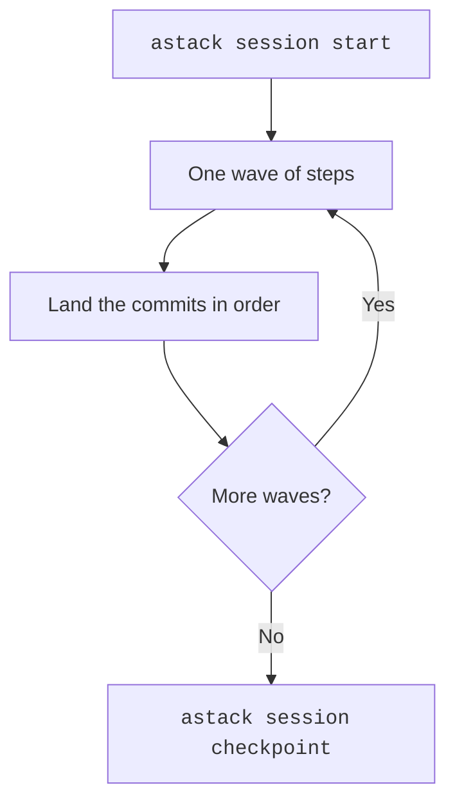

# astack

**Skills, rules and hooks for the path from a goal to a merged pull request.**

<p align="center">
  <picture>
    <source media="(prefers-color-scheme: dark)" srcset="docs/hero-dark.svg">
    
  </picture>
</p>

<p align="center"><a href="#quickstart">Install</a> · <a href="#how-it-works">Workflow</a> · <a href="marketplace/plugins/astack/skills/mode/references/card.md">Rule card</a></p>

astack is one plugin for AI coding agents. It gives the agent a planning method and a build loop that starts from a failing test. It adds review and hardening passes, and it stops before each decision that is yours. One source builds for Claude Code, Codex, Cursor, Grok Build, Grok Bot and other Agent Skills clients.

- **52 skills** for plans, code, review, the domain model, research, tickets, documents and tool control
- **Read-only reviewer agents** for TypeScript and PostgreSQL
- **Hooks** that guard the workflow and check reply language, types and comments
- **A CLI** (`astack`) for sessions, plan checks, the board and `doctor`


## Contents

- [Quickstart](#quickstart)
- [How it works](#how-it-works)
- [Why astack](#why-astack)
- [Install by client](#install-by-client)
- [The CLI](#the-cli)
- [Hook profiles](#hook-profiles)
- [Language review packs](#language-review-packs)
- [Build and verify](#build-and-verify)
- [Source layout](#source-layout)
- [Private companion](#private-companion)
- [Contribute](#contribute)
- [Licence and credits](#licence-and-credits)

## Quickstart

Install the signed release `v0.1.0`. See [the release list](https://github.com/vahaah/astack/releases).

You need Node 22 or later, or Bun.

```sh
ASTACK_TAG=v0.1.0
ASTACK_RELEASE="$HOME/.local/share/astack/releases/$ASTACK_TAG"
git clone --branch "$ASTACK_TAG" --depth 1 https://github.com/vahaah/astack.git "$ASTACK_RELEASE"
```

Before you install, review the tag's commit and verified signature. Use a new folder for each release.

The generated builds under `dist/` are committed, so the checkout is ready to install. For Claude Code:

```sh
claude plugin marketplace add "$ASTACK_RELEASE"
claude plugin install astack@astack
```

Then link the shared rules as [`dist/README.md`](dist/README.md) describes, and check the setup:

```sh
"$ASTACK_RELEASE/dist/claude-code/astack/bin/astack" doctor
```

Start work with `/astack:mode` (flat builds such as Cursor use `/astack-mode`). With no argument it reads the plan, the tracker and git, then does the next step. Or say what you want in plain words, such as "I am building X" or "merge when green".

## How it works

### The daily path



1. **Plan.** `/astack:plan` asks for the goal and the one decision the work drives. Later rounds ask only for choices that belong to you, each with one recommendation and lettered options.
2. **Build.** On a branch or worktree, never on the default branch. A feature grows one slice at a time, and each slice starts with a test that fails. A bug fix starts with `Root cause: X because Y`.
3. **Run the gates.** Lint, type check, tests and doc checks, matching CI. Run them again after the clean-up and after each fix. Report the counts in the PR.
4. **Clean the diff.** `/astack:deslop` and the comment check.
5. **Review.** `/astack:code-review` on two axes: standards and spec.
6. **Open the PR** from the session that owns the ticket.
7. **Harden.** `/astack:pr-review-hardening` reproduces each finding before it counts, and stops when the run is not clean.
8. **Merge** only with a grant in the profile or in that turn.
9. **Plan the next session.**

The full guide is [docs/workflow.md](docs/workflow.md). When the README and the rule card differ, the rule card wins: `marketplace/plugins/astack/skills/mode/references/card.md`.

### One plan session is one pull request

| Shape of the work | Start with |
|---|---|
| One ticket | `/astack:implement` |
| One plan session | `astack session start <plan>` |
| A stack of pull requests | Autopilot-stack |
| A programme | `astack board <plan>`, then Orchestrate |



Start a session with `astack session start <plan>`. The steps sit in waves, workers build them in worktrees, and the main thread lands the commits in plan order. `astack session checkpoint` writes the checkpoint on the PR. `astack board <plan>` shows the PRs to merge first, the active sessions and the work you can start. The board is a view, so do not commit it.

### Words that select a route

#### Start

| You say | astack does |
|---|---|
| "I am building X", or a ticket key | `/astack:plan` asks for the goal and the deciding choice, then grill rounds follow |
| "go", or "do your recommendation" | Records `delegate: on` and continues |
| "resume" | Reads the plan, tracker and git, then continues |
| "I need it fast" | Quick tier, at most one grill round |
| A bug or error report | Bug-fix path, root cause written before the fix |
| `/goal`, or "continue the board" | Programme tier, at most 5 sessions |

#### During

| You say | astack does |
|---|---|
| "comments" | Triages each PR comment, then fixes failing checks |
| UI polish, or a mobile check | `astack:control-ui` walks the journey as a real person |
| "pause" | Hard stop with a hand-off prompt |

#### Ship

| You say | astack does |
|---|---|
| "create pr" | Gates, deslop, comment check, PR text, then one hardening run if the profile asks |
| "update from main" | Merges the base branch and runs the gates again |
| "merge when green" | Ships, if a grant exists |

A rule of yours can add a route. It cannot remove one.

### Rules that always apply

- Push after the gates are green.
- Open the pull request.
- Update the pull request when the work changes.
- Merge only with a grant from the profile or from this turn.
- Stop for an account, a secret, paid infrastructure, a production write with no grant, or a destructive reset.
- Ask only for a choice that belongs to you.
- Give one recommendation and lettered choices.
- The word "agree" accepts the recommendations of the last round.
- One plan is one pull request.
- Put follow-up work in the open pull request.
- Report the gate counts.
- Walk the journey as a real person.
- Measure a claim before you make it.
- Keep the state in the plan, the tracker and git.
- Write each reply in ASD-STE100 Simplified Technical English.
- Give the result first.
- A checkpoint reply has 6 lines or fewer.
- Fix a broken skill in astack.
- Leave the copy in a project repository unchanged.

## Why astack

astack stands on other people's work. It adapts text from three MIT projects, listed file by file in [NOTICE](NOTICE). Each is worth using on its own, and the right choice depends on what you need.

| Option | What it gives you | When to choose it |
|---|---|---|
| A plain rules file (`AGENTS.md`, `CLAUDE.md`, Cursor rules) | Your conventions in one file, read every session | Small projects, or when you want no extra tooling |
| [pstack](https://github.com/cursor/plugins/tree/main/pstack) | Lauren Tan's (poteto) skills, principles and multi-model mode for rigorous agent work in Cursor | You want that method as its author maintains it |
| [Matt Pocock's skills](https://github.com/mattpocock/skills) | Small, composable engineering skills (grilling, TDD, review, triage) that work with any model | You want individual skills to pick from |
| [Cursor team kit](https://github.com/cursor/plugins/tree/main/cursor-team-kit) | The Cursor team's skills for CI, PRs and review | You work mainly in Cursor and want its team's flow |
| astack | One opinionated path from goal to merge, built for several clients | You want the same workflow, hooks and stops across clients |

What astack adds on top:

- **Enforcement, not only guidance.** Hooks check reply language, types and comments, and workflow guards stay on in every profile.
- **Owner stops.** The agent stops before merges with no grant, money, accounts, secrets and destructive resets.
- **CI parity.** The hardening gates mirror the repo's CI jobs, and a check keeps them in step.
- **One source, many clients.** A capability map decides what each client build receives.

The trade-off is that astack is opinionated. If its path does not fit, the projects above are good places to start.

## Install by client

All commands assume `ASTACK_RELEASE` points at your checkout (see [Quickstart](#quickstart)).

### Claude Code and Grok Build

```sh
claude plugin marketplace add "$ASTACK_RELEASE"
claude plugin install astack@astack
```

The plugin carries its CLI and hooks. Link the shared rules as [`dist/README.md`](dist/README.md) describes. Grok Build uses the Claude plugin build through its own marketplace install.

### Codex

```sh
codex plugin marketplace add "$ASTACK_RELEASE"
codex plugin add astack@astack
```

Then follow [`dist/codex/README.md`](dist/codex/README.md). Trust the four astack hooks in `/hooks` and put the CLI on `PATH`. Add the rules fragment with `astack print codex-agents`. Codex calls skills with `$`, as in `$astack:plan`.

### Cursor

Use the local-copy procedure in [`dist/cursor/astack/README.md`](dist/cursor/astack/README.md). The build includes flat skills, scoped rules, read-only reviewers and hooks. For cloud agents, see [the Cursor cloud guide](docs/runbooks/install-cursor-cloud.md).

### Grok Bot

Follow [the Grok Bot guide](docs/runbooks/install-grok-bot.md). This target ships no astack hooks.

### Other Agent Skills clients

`dist/agentskills/` holds portable skills and a rules fragment. Use a project install and keep each skill's other files. Avoid duplicate global copies when a client already loads the plugin.

## The CLI

```sh
"$ASTACK_RELEASE/dist/claude-code/astack/bin/astack" --help
```

| Command | Purpose |
|---|---|
| `astack session start\|checkpoint\|handoff\|resume` | Run one plan session |
| `astack board <plan>` | Show what to merge, what is active and what can start |
| `astack check plan\|pr\|ticket\|ste\|types\|comments` | Run one check |
| `astack init` | Write `.astack/profile.json` for a repo |
| `astack doctor` | Report the runtime, installed copies, duplicate skills and hook trust. Read only |
| `astack skill-path <plugin>:<skill> [file]` | Print the path of a skill file |

Keep the plugin folder beside the launcher so reference discovery works. The standalone `dist/cli/astack.js` serves checks in CI and git hooks and carries no skill library.

## Hook profiles

Strict is the default. Minimal turns off the STE, type and comment checks. Each group can be overridden with a Boolean, and the workflow guards stay on.

```json
{
  "hooks": {
    "profile": "minimal",
    "types": true
  }
}
```

Put this in `.astack/profile.json`. See [the hook profile guide](docs/runbooks/hook-profiles.md).

## Language review packs

The TypeScript pack covers `.ts`, `.tsx`, `.mts` and `.cts`. The PostgreSQL pack covers SQL in PostgreSQL repos. The optional `typescript-reviewer` and `postgres-reviewer` agents share those checklists and use only the Read, Grep and Glob tools. The parent agent runs the proof and makes the fixes.

## Build and verify

```sh
bun install --frozen-lockfile
bun run check:drift
bun run check
```

`check:drift` compares fresh build output with the committed files without rewriting them. `check` builds every target and runs validation, neutrality and secret scans, STE checks, tests, formatting, lint and type checks. The authenticated Claude load test needs an API key or OAuth token and is reported as skipped without one.

## Source layout

| Folder | Purpose |
|---|---|
| `marketplace/plugins/astack/` | Plugin source: skills, agents, hooks, launcher |
| `src/astack/` | CLI and hook implementation |
| `rules/` | Shared rules, language packs and the generated rule card |
| `scripts/` | Build, apply, scans and per-client renderers |
| `dist/` | Generated builds, one folder per client |
| `tests/` | Tests and synthetic fixtures |
| `upstream/` | Frozen snapshots for licence evidence and tests |
| `docs/` | Design, decisions, workflow and runbooks |

Change generated files at their source. `AGENTS.md` names each generated path and its build command. Private config stays in the [private companion](#private-companion).

## Private companion

Keep project configs, machine settings, private rules and deny lists in a separate private repository.
Pass its path through `--companion` or `ASTACK_COMPANION_DIR`.
Without one, read commands use the synthetic example.
Write commands refuse that example.

[The companion guide](docs/runbooks/private-companion.md) explains the layout.
[The repository install guide](docs/install-repo.md) covers apply and branch overlays.
Public CI uses synthetic data and cannot identify every private value of an owner.

## Contribute

Read [CONTRIBUTING.md](CONTRIBUTING.md). Report security issues privately through [SECURITY.md](SECURITY.md).

## Licence and credits

MIT, Copyright (c) 2026 Alex Vakhitov. astack adapts material from [pstack](https://github.com/cursor/plugins/tree/main/pstack) by Lauren Tan, [mattpocock/skills](https://github.com/mattpocock/skills) by Matt Pocock and the [Cursor team kit](https://github.com/cursor/plugins/tree/main/cursor-team-kit) by Cursor, all MIT. [NOTICE](NOTICE) lists the files that hold each project's material.
