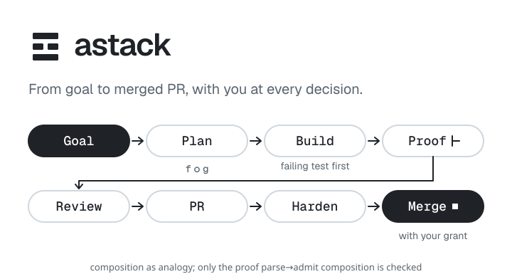
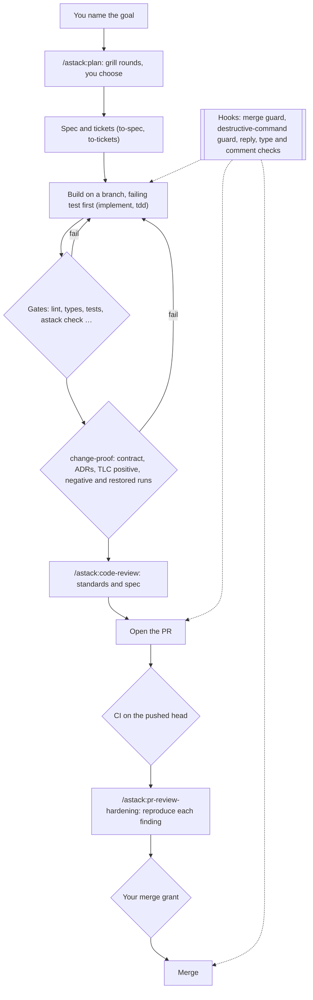
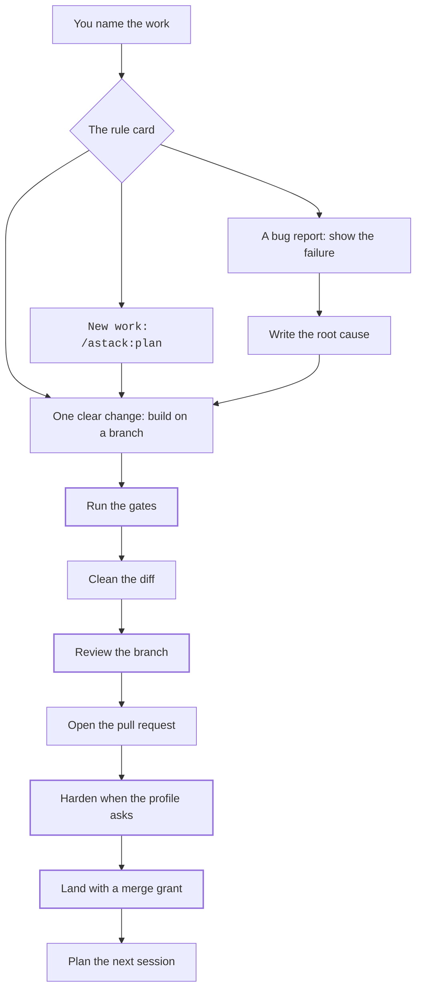
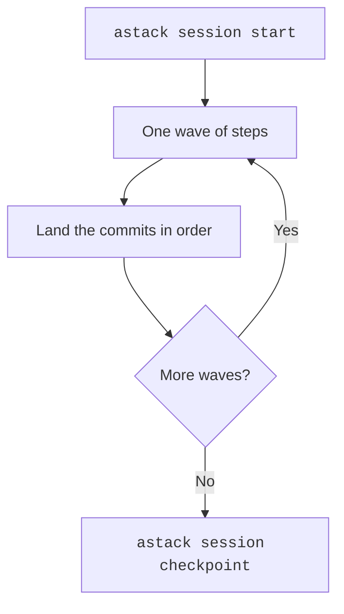

# astack

**From goal to merged PR, with you at every decision.**

<p align="center">
  <picture>
    <source media="(prefers-color-scheme: dark)" srcset="docs/hero-dark.svg">
    
  </picture>
</p>

<p align="center"><a href="#quickstart">Install</a> · <a href="#how-it-works">Workflow</a> · <a href="marketplace/plugins/astack/skills/mode/references/card.md">Rule card</a></p>

astack is a plugin for AI coding agents. Its skills and rules give the agent one path from a goal to a merged pull request. The path is plan, build test-first on a branch, run the gates, review, open the PR, harden and merge. The agent stops before each decision that belongs to you. One source builds for Claude Code, Codex, Cursor, Grok Build, Grok Bot and other Agent Skills clients.

- **52 skills** in the plugin for plans, code, review, the domain model, research, tickets, documents and tool control. The Grok Bot build adds `astack-rules` and `astack-sync`, giving 54.
- **Six agents.** `typescript-reviewer` and `postgres-reviewer` are read-only (Read, Grep and Glob only). `explorer`, `researcher`, `delegate` and `comment-judge` are used by the skills. Those four are not limited to Read, Grep and Glob.
- **Five shared rules files** in `rules/`: `astack`, `coding`, `comments`, `typescript` and `postgres`.
- **Hooks** for Claude Code, Codex, Cursor and Grok Build. They check reply language, types, comments, PR and ticket text. They also guard merges and destructive commands. They fail open. If a handler throws, the action is allowed.
- **A CLI** (`astack`) for sessions, the board, `doctor` and repository checks, including `astack check proof`.
- **A required change proof.** A repo that applies the astack profile gets a mandatory `change-proof` gate. The gate admits a change only with a domain contract, accepted ADR decisions and a passing TLC run of a bounded TLA+ model. The run includes a mutated model that must fail.

## What is checked, and where

| Layer | What runs | Where | What it guarantees |
|---|---|---|---|
| Skills and rules | Instructions the agent follows: plan, TDD, deslop, review, hardening | In the agent | Nothing by itself. They guide the agent, and a model can still ignore them |
| Hooks | `astack hook <client> <event>` for Claude Code, Codex and Grok Build. Cursor uses `astack hook cursor <event>` | In the client, on each event | Blocks some actions, such as a merge with no grant or a destructive command. Fails open on a thrown handler. Grok Bot has no hooks |
| CLI checks | `astack check …` (see [The CLI](#the-cli)) | Locally and in CI | A pass or a fail for the property that check names. `review-growth` warns and still exits 0. `ci-pins` can exit 3 |
| CI | This repo's Check workflow runs `bun run check` on push and on pull request. A product repo runs its own workflows. The hardening profile gates mirror those jobs, and the agent runs them, including `change-proof` | On the runner, and in the hardening run | A pull request workflow tests the merge of the head into the base. GitHub reports the check on the head. The proof gate still requires the manifest `base` |
| You | Grants for merges, accounts, secrets, money and destructive actions, and the choices in each plan round | In the conversation or the profile | Every decision astack does not automate |



<details>
<summary>Text version of the flow chart</summary>

You name the goal. `/astack:plan` asks for your choices.
Spec and ticket skills split the work. The agent builds on a branch, starting from a failing test.
The gates run lint, types, tests and the astack checks. A failure returns to the build.
The `change-proof` gate checks the contract and ADRs and runs TLC. A failure returns to the build.
The agent reviews the branch and opens the PR.
CI runs on the pushed head. A pull request workflow tests the merge into the base.
Hardening reproduces each finding. The merge happens only with your grant.
Hooks watch the build, the PR and the merge in clients that support hooks.

</details>

## Contents

- [Quickstart](#quickstart)
- [What is checked, and where](#what-is-checked-and-where)
- [How it works](#how-it-works)
- [Foundations](#foundations)
- [Why astack](#why-astack)
- [Install by client](#install-by-client)
- [The CLI](#the-cli)
- [Hooks in detail](#hooks-in-detail)
- [Applying astack to a repo](#applying-astack-to-a-repo)
- [Runtimes, files and environment](#runtimes-files-and-environment)
- [Releases](#releases)
- [Hook profiles](#hook-profiles)
- [Language review packs](#language-review-packs)
- [Build and verify](#build-and-verify)
- [Source layout](#source-layout)
- [Private companion](#private-companion)
- [Contribute](#contribute)
- [Licence and credits](#licence-and-credits)

## Quickstart

Install the signed release `v0.1.0`. See [the release list](https://github.com/vahaah/astack/releases).

The CLI runs on Node 22 or later, or on Bun. `bun run check` and `bun run apply` need Bun. `astack check proof` and the `change-proof` gate also need Java 17 or later. The checker fetches the pinned TLA+ `tla2tools.jar` v1.7.4 and verifies its SHA-256 on every use. See the [formal-model runbook](docs/runbooks/formal-models.md).

> **Upgrading a repo that already uses astack?** Releases with the proof gate make `change-proof` a mandatory gate on `bun run apply`. A repo without `.astack/proof.json`, a TLA+ model and a governing ADR fails that gate. Follow the [migration guide](docs/runbooks/change-proof-migration.md) in one adoption PR before you apply the new profile.

```sh
ASTACK_TAG=v0.1.0
ASTACK_RELEASE="$HOME/.local/share/astack/releases/$ASTACK_TAG"
git clone --branch "$ASTACK_TAG" --depth 1 https://github.com/vahaah/astack.git "$ASTACK_RELEASE"
```

Before you install, review the tag's commit and verified signature. Use a new folder for each release.

The generated builds under `dist/` are committed, so the checkout is ready to install. For Claude Code:

```sh
claude plugin marketplace add "$ASTACK_RELEASE"
claude plugin install astack@astack
```

Then link the shared rules as [`dist/README.md`](dist/README.md) describes, and check the setup:

```sh
"$ASTACK_RELEASE/dist/claude-code/astack/bin/astack" doctor
```

Start work with `/astack:mode` (flat builds such as Cursor use `/astack-mode`). With no argument it reads the plan, the tracker and git, then does the next step. Or say what you want in plain words, such as "I am building X" or "merge when green".

## How it works

### The daily path



<details>
<summary>Text version of the daily path chart</summary>

You name the work.
The rule card selects the route.
New work starts with `/astack:plan`, then a build.
One clear change goes straight to a build on a branch.
A bug report shows the failure, then you write the root cause, then you build.
The build runs the gates.
You clean the diff, review the branch and open the pull request.
You harden when the profile asks.
You land with a merge grant, then plan the next session.

</details>

1. **Plan.** `/astack:plan` asks for the goal and the one decision the work drives. Later rounds ask only for choices that belong to you, each with one recommendation and lettered options.
2. **Build.** On a branch or worktree, never on the default branch. A feature grows one slice at a time, and each slice starts with a test that fails. A bug fix starts with `Root cause: X because Y`.
3. **Run the gates.** Lint, type check, tests and doc checks, matching CI. Run them again after the clean-up and after each fix. Report the counts in the PR.
4. **Clean the diff.** `/astack:deslop` and the comment check.
5. **Review.** `/astack:code-review` on two axes: standards and spec.
6. **Open the PR** from the session that owns the ticket.
7. **Harden.** `/astack:pr-review-hardening` reproduces each finding before it counts, and stops when the run is not clean.
8. **Merge** only with a grant in the profile or in that turn.
9. **Plan the next session.**

The full guide is [docs/workflow.md](docs/workflow.md). The rule card routes each session. This page states the limits of each check. The card is [marketplace/plugins/astack/skills/mode/references/card.md](marketplace/plugins/astack/skills/mode/references/card.md).

### One plan session is one pull request

| Shape of the work | Start with |
|---|---|
| One ticket | `/astack:implement` |
| One plan session | `astack session start <plan>` |
| A stack of pull requests | Autopilot-stack |
| A programme | `astack board <plan>`, then Orchestrate |



<details>
<summary>Text version of the session chart</summary>

`astack session start` starts one wave of steps.
That wave lands the commits in order.
When more waves remain, the session starts another wave.
When no wave remains, `astack session checkpoint` records the point.

</details>

Start a session with `astack session start <plan>`. The steps sit in waves. Workers build them in worktrees, and the main thread lands the commits in plan order. `astack session checkpoint` prints a package. The session skill posts that package on the PR. `astack board <plan>` shows the PRs to merge first, the active sessions and the work you can start. The board is a view. Do not commit it.

### Words that select a route

#### Start

| You say | astack does |
|---|---|
| "I am building X", or a ticket key | `/astack:plan` asks for the goal and the deciding choice, then grill rounds follow |
| "go", or "do your recommendation" | Records `delegate: on` and continues |
| "resume" | Reads the plan, tracker and git, then continues |
| "I need it fast" | Quick tier, at most one grill round |
| A bug or error report | Bug-fix path, root cause written before the fix |
| `/goal`, or "continue the board" | Programme tier, at most 5 sessions |

#### During

| You say | astack does |
|---|---|
| "comments" | Triages each PR comment, then fixes failing checks |
| UI polish, or a mobile check | `astack:control-ui` walks the journey as a real persona |
| "pause" | Hard stop with a hand-off prompt |

#### Ship

| You say | astack does |
|---|---|
| "create pr" | Gates, deslop, the comment check and the PR text. One hardening run follows when the profile sets `after_create_pr` to `harden` |
| "update from main" | Merges the PR base, or `main`, and runs the gates again |
| "merge when green" | Ships, if a grant exists |

A user rule in the rules folder can add a route. It cannot remove one.

### Rules that always apply

- Push after the gates are green.
- Open the pull request.
- Update the pull request when the work changes.
- Merge only with a grant from the profile or from this turn.
- Stop for an account, a secret, paid infrastructure, a production write with no grant, or a destructive reset.
- Stop for a force-push to a shared branch, an `--admin` merge, or a message to a client.
- Ask only for a choice that belongs to you.
- Give one recommendation and lettered choices.
- The word "agree" accepts the recommendations of the last round.
- One plan is one pull request.
- Put follow-up work in the open pull request.
- Report the gate counts.
- Walk the journey as a real persona.
- Measure a claim before you make it.
- Keep the state in the plan, the tracker and git.
- Write each reply in ASD-STE100 Simplified Technical English.
- Give the result first.
- A checkpoint reply has 6 lines or fewer.
- Fix a broken skill or rule in astack.
- Leave the copy in a project repository unchanged.

## Why astack

astack stands on other people's work. It adapts text from three MIT projects, listed file by file in [NOTICE](NOTICE). Each is worth using on its own. The right choice depends on what you need.

| Option | What it gives you | When to choose it |
|---|---|---|
| A plain rules file (`AGENTS.md`, `CLAUDE.md`, Cursor rules) | Your conventions in one file, read every session | Small projects, or when you want no extra tooling |
| [pstack](https://github.com/cursor/plugins/tree/main/pstack) | Lauren Tan's (poteto) skills, principles and multi-model mode for rigorous agent work in Cursor | You want that method as its author maintains it |
| [Matt Pocock's skills](https://github.com/mattpocock/skills) | Small, composable engineering skills (grilling, TDD, review, triage) that work with any model | You want individual skills to pick from |
| [Cursor team kit](https://github.com/cursor/plugins/tree/main/cursor-team-kit) | The Cursor team's skills for CI, PRs and review | You work mainly in Cursor and want its team's flow |
| astack | One opinionated path from goal to merge, built for several clients | You want the same workflow, hooks and stops across clients |

What astack adds on top:

- **Checks as well as guidance.** Hooks check reply language, types and comments. The workflow guards stay on in every profile. Hooks can fail open, and Grok Bot has none. A gate runs in CI only when a workflow runs it.
- **Owner stops.** The agent stops before merges with no grant, money, accounts, secrets and destructive resets.
- **CI parity.** The companion config lists `ciOnlyGates` and `ciParity`. Apply compares the hardening gates with the repo workflows and writes those gates into the hardening profile.
- **One source, many clients.** A capability map decides what each client build receives.

The trade-off is that astack is opinionated. If its path does not fit, the projects above are good places to start.

## Foundations

### What ChangeProof proves, and what it does not

`astack check proof` reads `.astack/proof.json` and admits the change only when all of these hold:

1. The manifest parses as version 1 JSON with only its known keys. Its `base` is a full commit and an ancestor of `HEAD`. When you pass `--base`, that ref resolves to the same commit.
2. Its `scope` rows cover every changed, staged, removed and untracked path.
3. The domain contract resolves. That is the glossary, the aggregate symbol, the terms and invariants, and each cited ADR decision. A cited ADR must have status Accepted, unless the reference has an `integrated-proposal` ratification. Then the governing ADR stays Proposed and the process ADR stays Accepted. ADR 0007 is superseded by ADR 0008. The code does not limit that route to those two files. `governingMetadata` set to `landed-header-value` is the ADR 0008 option. It allows one `Landed` header value to differ.
4. The spec-drift matrix passes, and each named criterion has a links row.
5. TLC (`tla2tools.jar` 1.7.4, SHA-256 pinned) passes the model, then finds the named violation in the declared negative mutation, then passes the restored model. Each run uses a temporary copy. Each run has a deadline of at most 60 seconds. The candidate inputs are hashed before and after the runs. The check does not read a stored receipt.

Exit 0 means admitted. Exit 1 means missing or invalid evidence, or a tool failure. Exit 2 means wrong arguments or a schema failure. `--summary` prints the intent as `UNVERIFIED` and runs nothing, so it is never a proof.

The manifest fields are `version`, `change`, `base`, `scope`, `domain`, `category`, `abstraction`, `model`, `negative` and `limits`. The [proof contract](marketplace/plugins/astack/skills/pr-review-hardening/references/proof-contract.md) defines each field.

In this repository the positive run explores 276 distinct states. The negative mutation violates `LandingAuthoritySafe` with a counterexample of 9 states. The receipt names the head commit and a digest of the candidate inputs. Those inputs are the index, the worktree files and any ratification history.

What it does **not** prove:

- **That the code matches the model.** Each `relation` row names a function and a model action. The check requires that symbol to occur in the named file. It does not check that the function implements the action. Tests and review cover that link.
- **Anything beyond the model's bounds.** TLC explores a finite state space under the stated assumptions.
- **That the model is about the change.** A `**` scope with one model admits any path, so the coverage is only as specific as the manifest.
- **Facts outside the model,** such as the truth of an ADR's `Landed` value. ADR 0008 leaves that to human review.

### Category theory: what is real and what is analogy

What the code does:

- **One typed composition, checked on a model.** `parseChangeProof` maps text to `Result<ChangeProof, Rejection>`. `admitChangeProof` maps that value to `Result<Admitted, Rejection>`. `astack check proof` parses first. A bad parse stops before the model runs. Admission runs after the three TLC runs. `tests/astack/proof-composition.ts` defines `proofForSnapshot`, which returns the first rejection and does not admit a bad parse. There is no generic `bind` helper. [ADR 0006](docs/adr/0006-internal-composition-records-follow-domain-effects.md) gives the identity and associativity argument on paper. TLC checks `ResultLeftIdentity`, `ResultRightIdentity` and `ResultAssociativity` on a finite encoding of the Result carrier. That encoding uses two values, two errors and all total functions between them. TLC does not check the TypeScript functions. The manifest field `typedWitness` is a separate file. This repository names `tests/astack/governing-authority.test.ts`. Admission checks that this file names each arrow symbol.
- **Composition records in each manifest.** The `category` section names objects, arrows, effects, equality and, for each law, either a witness or a reason it does not apply. `readLaw` in `src/astack/change-proof/contract.ts` requires a reason when a law is `not_applicable`. A pure carrier cannot witness a monad law. `lawProblem` in that file rejects the claim. ADR 0006 states the same rule. The manifest in this repository marks every law not applicable. It names no witness.

What is only analogy:

- **The workflow.** Plan, build, review and merge are not a category. The skills are not morphisms with checked types. Skills pass work through files and git, not through typed interfaces.
- **Gates.** A gate is a command in the hardening profile that exits zero or not. It is not a typed arrow.
- **The hero image.** `f ∘ g` on the return arrow, `⊢` and `∎` are notation for the idea, not claims about the code. The caption is "Composition as analogy. Only proof parse→admit is typed."

## Install by client

All commands assume `ASTACK_RELEASE` points at your checkout (see [Quickstart](#quickstart)).

### Claude Code and Grok Build

```sh
claude plugin marketplace add "$ASTACK_RELEASE"
claude plugin install astack@astack
```

The plugin carries its CLI and hooks. Link the shared rules as [`dist/README.md`](dist/README.md) describes. Grok Build uses the Claude plugin build through its own marketplace install.

### Codex

```sh
codex plugin marketplace add "$ASTACK_RELEASE"
codex plugin add astack@astack
```

Then follow [`dist/codex/README.md`](dist/codex/README.md). Trust the four astack hooks in `/hooks` and put the CLI on `PATH`. Add the rules fragment with `astack print codex-agents`. Codex calls skills with `$`, as in `$astack:plan`.

### Cursor

Use the local-copy procedure in [`dist/cursor/astack/README.md`](dist/cursor/astack/README.md). The build includes flat skills, scoped rules, read-only reviewers and hooks. For cloud agents, see [the Cursor cloud guide](docs/runbooks/install-cursor-cloud.md).

### Grok Bot

Follow [the Grok Bot guide](docs/runbooks/install-grok-bot.md). This target ships no astack hooks.

### Other Agent Skills clients

`dist/agentskills/` holds portable skills and a rules fragment. Use a project install and keep each skill's other files. Avoid duplicate global copies when a client already loads the plugin.

## The CLI

```sh
"$ASTACK_RELEASE/dist/claude-code/astack/bin/astack" --help
```

| Command | Purpose |
|---|---|
| `astack session start\|checkpoint\|handoff\|resume` | Run one plan session. Checkpoint prints a package for the skill to post on the PR |
| `astack board <plan>` | Show what to merge, what is active and what can start. Do not commit the board |
| `astack check plan\|pr\|ticket\|ste\|types\|comments` | Run one check |
| `astack check pr-head` | Check that HEAD equals or descends from the PR head fetched with `gh` |
| `astack check ci-pins --base <ref>` | Compare CI tool versions with the merge base. Exit 3 and a `ci_proof:` line when the versions stay the same. A changed tool version exits 1 |
| `astack check review-growth` | Report advisory diff growth since the fixed first-review commits. A warning still exits 0 |
| `astack check spec-drift` | Check that each declared criterion links to a test control. A pass shows traceability, not coverage. Findings exit 1 |
| `astack check proof [--summary]` | Admit a change only with a domain contract, accepted ADRs, composition records and passing TLC runs. `--summary` runs nothing and prints `UNVERIFIED`. Needs Java 17 or later |
| `astack check comments\|types [--staged\|--base <ref>]` | Fail when an added comment is in a class that no keep rule covers, or when an unsafe type-pattern count rises in a file |
| `astack check migrations` | Compare the migrations a local Supabase stack applied with the files on the branch. It prints a reset command and never runs it |
| `astack check stack-config` | Compare watched files with the record from `astack stack start`. It prints a restart command and never runs it |
| `astack stack start` | Start a long-lived local Supabase stack and record the watched files of this checkout |
| `astack plan …`, `astack plan-ticket` | Plan trail, drafts, the delegation grant, tracker export, import, move and drift. These print write plans and never call a tracker |
| `astack watch-pr [--pr <n>] [--stack]` | Watch a pull request, its open stack or a queued stack through `gh`, and print each verdict |
| `astack orch` | Read and write the plain-file store of an orchestrate run. A missing record exits 2 |
| `astack managed <path>` | Exit 0 when apply writes the path, 1 when the repo owns it, and 2 when the profile cannot tell |
| `astack print codex-agents\|cursor-install` | Print install text from the repository build |
| `astack init` | Write `.astack/profile.json` for a repo. It never makes a commit |
| `astack doctor` | Report the runtime, installed copies, duplicate skills and hook trust. Read only |
| `astack skill-path <plugin>:<skill> [file]` | Print the path of a skill file |

Keep the plugin folder beside the launcher so reference discovery works. The standalone `dist/cli/astack.js` serves checks in CI and git hooks and carries no skill library.

The [review checks runbook](docs/runbooks/review-checks.md) gives the commands for `review-growth` and `spec-drift`.

### Change proof

`astack check proof` reads `.astack/proof.json` at the repo root. The manifest names a fixed `base` commit, the `scope` paths and their obligations. It also names the TLA+ model references and the domain contract. That contract is the glossary, the aggregate, the terms and the invariants. The check fails when any part is missing or stale. Fetch enough git history in CI for `base` to resolve.

`bun run apply` requires one gate named `change-proof`. That gate cannot be optional or limited to some paths. Its command runs `astack check proof`. `review-growth` warns and still exits 0. `spec-drift` exits 1 when a link is missing. Neither replaces the proof gate. Add `interrogate` only when you want that review.
The [formal-model runbook](docs/runbooks/formal-models.md) gives the required workflow and the retry tutorial.
The [migration guide](docs/runbooks/change-proof-migration.md) explains adoption in existing repositories.

## Hooks in detail

Claude Code, Codex and Grok Build call `astack hook <client> <event>`. Their events are session start, prompt submit, tool use and stop. Cursor calls `astack hook cursor <event>` and uses its own event names for the same handlers. The command exits 2 to deny, and writes the reason on stderr. If a handler throws, the dispatcher allows the action (`src/astack/hook/dispatch.ts`). If `gh` cannot list pull requests, the duplicate-PR guard allows the action.

| Handler | Runs on | What it does | Off under `minimal` |
|---|---|---|---|
| `merge-guard` | prompt, shell, MCP | Denies a merge with no grant in the profile or the turn. It reads the pull request with `gh` | No |
| `destructive` | shell | Denies `supabase db reset`, including a package script that runs it, and a force-push to a shared branch such as `main`, when there is no owner grant. It also denies `git commit` or `git push` with `--no-verify` | No |
| `duplicate-pr` | shell, MCP | Denies `gh pr create` for a branch that already has an open PR, or a body that shares a ticket key with an open PR | No |
| `pr-body`, `ticket` | shell, MCP | Check PR headings and issue text, including `Part of` links | No |
| `plan-file` | write and edit | Denies a plan write over the byte cap, or a new checkbox, `Status:` line or register table | No |
| `plan-pointer` | session start | Adds a note that points the session at its plan. It does not deny | No |
| `turn` | prompt, reply | Keeps per-turn state in the state folder. The STE follow-up note is skipped when `ste` is off | No |
| `ste-reply`, `ste-artifact` | reply; write, edit, shell, MCP | ASD-STE100 checks | Yes |
| `types` | write, edit, shell | Denies a rise in unsafe type patterns | Yes |
| `comments` | write, edit, shell | Denies a comment that no keep rule covers | Yes |

## Applying astack to a repo

`bun run apply` is a script in this checkout, not an `astack` command. It reads `projects/<name>.json` from the [private companion](#private-companion). It writes the managed files, `.astack/profile.json` and the hardening profile. The gates live in the hardening profile. Apply does not write `.astack/proof.json`. Run a dry run first. See [the repository install guide](docs/install-repo.md). `astack init` writes only a starter `.astack/profile.json` and never makes a commit.

## Runtimes, files and environment

| Need | Used for |
|---|---|
| Node 22 or later (`engines`) | The CLI and hooks. CI uses Node 24.13.1 |
| Bun (CI pins 1.4.3) | `bun run check`, `bun run apply` and the other repo scripts |
| Java 17 or later | `astack check proof` and the `change-proof` gate |
| `gh`, authenticated | `check pr-head`, `watch-pr`, and the merge and duplicate-PR guards |

| File or variable | Meaning |
|---|---|
| `.astack/profile.json` | Tracker, merge grant, hook profile, STE mode, plan folders, `commentKeep`, `managed`, `neutral`, `types` and `maxCommentLines`. Gates are not in this file |
| `.astack/proof.json` | The ChangeProof manifest. Prepare it in the repo. Apply does not write it |
| `.claude/pr-review-hardening.profile.md` | The hardening profile. Its gates mirror CI, including the mandatory `change-proof` gate |
| `ASTACK_TLC_JAR` | Absolute path of a pinned `tla2tools.jar` outside the repo |
| `ASTACK_PROOF_TIMEOUT_MS` | Whole number from 1 to 60000. It can only lower the 60 second deadline of each TLC run |
| `ASTACK_STATE_DIR` | State folder. Else `$XDG_STATE_HOME/astack`, else `~/.local/state/astack` |
| `ASTACK_COMPANION_DIR` | The private companion folder |
| `ASTACK_RUNTIME` | Optional path to `node` or `bun` for the launcher. `astack doctor --save-runtime` writes the current runtime to `~/.local/state/astack/runtime` |

## Releases

A push of a `v*` tag runs `.github/workflows/release.yml`. `scripts/release.ts` accepts only an annotated tag whose name is `v` plus the package version. GitHub must report the signature as verified, with reason `valid`. The job runs `check:drift`, `check` and a clean-tree check. It then creates a draft release with no assets. The owner reviews that draft and publishes it. Install from the tag source.

## Hook profiles

Strict is the default. Minimal turns off the STE, type and comment checks. Each group can be overridden with a Boolean. The workflow guards stay on. An invalid `hooks` object keeps the strict policy.

```json
{
  "hooks": {
    "profile": "minimal",
    "types": true
  }
}
```

Put this in `.astack/profile.json`. See [the hook profile guide](docs/runbooks/hook-profiles.md).

## Language review packs

The TypeScript pack covers `.ts`, `.tsx`, `.mts` and `.cts`. The PostgreSQL pack covers SQL in PostgreSQL repos. The optional `typescript-reviewer` and `postgres-reviewer` agents share those checklists and use only the Read, Grep and Glob tools. The parent agent runs the proof and makes the fixes.

## Build and verify

```sh
bun install --frozen-lockfile
bun run check:drift
bun run check
```

Java 17 or later must be on `PATH`, because `check` runs the repo's own change proof. `bun run check` runs that proof twice. The `test` script runs it, and `check` runs it again at the end.

`check:drift` compares fresh build output with the committed files and does not rewrite them. `check` builds every target. It runs validation, neutrality and secret scans, STE checks, tests, formatting, lint and type checks. The authenticated Claude load test needs an API key or OAuth token. It is reported as skipped without one.

## Source layout

| Folder | Purpose |
|---|---|
| `marketplace/plugins/astack/` | Plugin source: skills, agents, hooks, launcher |
| `src/astack/` | CLI and hook implementation |
| `rules/` | Shared rules, language packs and the generated rule card |
| `scripts/` | Build, apply, scans and per-client renderers |
| `dist/` | Generated builds, one folder per client |
| `tests/` | Tests and synthetic fixtures |
| `upstream/` | Frozen snapshots for licence evidence and tests |
| `docs/` | Design, decisions, workflow and runbooks |

Change generated files at their source. `AGENTS.md` names each generated path and its build command. Private config stays in the [private companion](#private-companion).

## Private companion

Keep project configs, machine settings, private rules and deny lists in a separate private repository.
Pass its path through `--companion` or `ASTACK_COMPANION_DIR`.
Without one, read commands use the synthetic example.
Write commands refuse that example.

[The companion guide](docs/runbooks/private-companion.md) explains the layout.
[The repository install guide](docs/install-repo.md) covers apply and branch overlays.
Public CI uses synthetic data and cannot identify every private value of an owner.

## Contribute

Read [CONTRIBUTING.md](CONTRIBUTING.md). Report security issues privately through [SECURITY.md](SECURITY.md).

## Licence and credits

MIT, Copyright (c) 2026 Alex Vakhitov. astack adapts material from [pstack](https://github.com/cursor/plugins/tree/main/pstack) by Lauren Tan, [mattpocock/skills](https://github.com/mattpocock/skills) by Matt Pocock and the [Cursor team kit](https://github.com/cursor/plugins/tree/main/cursor-team-kit) by Cursor, all MIT. [NOTICE](NOTICE) lists the files that hold each project's material.
