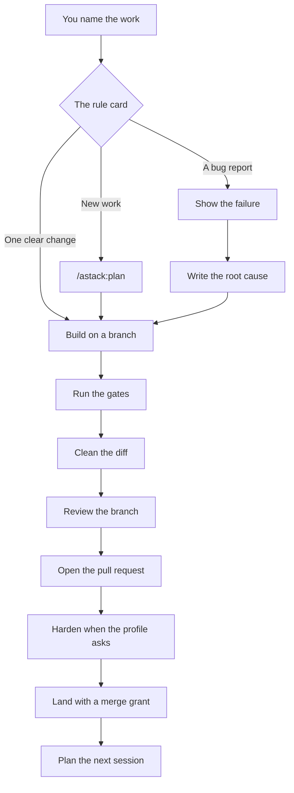
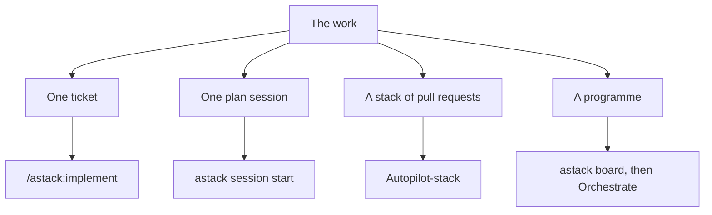
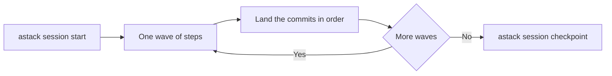

# astack

astack holds skills, agents, rules, and hooks for planning, coding, review, tickets, and documentation.
One `astack` plugin supplies text adapted from pstack, Matt Pocock, and Cursor.
This repository holds the source and each generated client build.
`LICENSE` and `NOTICE` record the licence and credits.
Credits stay in these package files and the licence files of standalone skills.
Rules and skill instructions carry no credit blocks.

Use this repository for the path from a goal to a merged pull request.
[The workflow guide](docs/workflow.md) gives each step.
The charts below are the same path.

## Workflow

Say what you want in plain words.
The rule card selects the route.
You can also start `/astack:mode` with no argument.
Mode reads the plan, the tracker and git.
Then it does the next step.

When this page and the rule card differ, the rule card wins.
The card is `marketplace/plugins/astack/skills/mode/references/card.md`.

### Daily path

Use this path for a change that you own.
Do not build on the default branch.



A feature grows one slice at a time.
Each slice starts with a test that fails.
A bug fix starts from the failure that you can show.
Write the root cause before the fix.
Run the gates again after the clean-up.
Run them again after each fix.

Open the pull request from the session that owns the ticket.
Run `/astack:pr-review-hardening` when the profile asks for it.
Stop that run when it is not clean.
Continue only when you say so.
A merge needs a grant in the profile or in that turn.

### Words that select a route

A rule of yours can add a route.
It cannot remove a route.
This table is the set that you use most.

| You say | astack does |
|---|---|
| "I am building X", or you give a ticket key | `/astack:plan` asks for the goal and for the one decision that the work drives. Grill rounds follow. |
| `/plan` | Plan mode stays short. Open questions come last. After you approve, the first commit writes `docs/plans/<slug>.md`. |
| `/grilling` | Each round covers the open questions. Each question has one recommendation and lettered options. |
| "go", or "do your recommendation" | The plan records `delegate: on`. The work continues. "agree", "next" and "approve" accept the last recommendations. |
| "resume" | Mode reads the plan, the tracker and git. Then it continues from the next step. |
| `/goal`, or "continue the board" | Programme tier. At most 5 sessions. Merge the open pull requests first. |
| "I need it fast" | Quick tier. At most one grill round. |
| A bug, an error report, or a tester report | Bug-fix path. Write `Root cause: X because Y` before the fix. Read a tester report with care before you accept its scope. |
| "comments", or "check github comments" | Triage each comment. Fix or answer it. Then fix the failing checks. |
| `/pr-review-hardening` | Hardening uses the profile cap. The default cap is 2. |
| "create pr" | Gates, deslop, the comment check, the pull request text, then one hardening run when the profile asks. |
| "update from main" | Merge the base branch. Run the gates again. Keep the intent of the ticket. |
| "merge", or "merge when green" | Shipping. A merge needs a grant from the profile or from this turn. |
| UI polish, or a mobile check | `astack:control-ui` walks the journey as a real person and uses the UI kit of the repository. |
| "pause", "prompt for next session", or "clean worktrees" | Pause is a hard stop. You get the hand-off prompt. Worktree cleanup comes after you record the worktree list. |

### Shapes of the work



One plan session is one pull request.
Start it in a fresh session with `astack session start <plan>`.
The steps sit in waves.
Workers build the steps in worktrees.
The main thread lands those commits in plan order.



`astack session checkpoint` writes the checkpoint on the pull request.
`astack board <plan>` shows the pull requests to merge first, the active sessions and the work that you can start.
The board is a view.
Do not commit it.

### Rules that always apply

- Push after the gates are green.
- Open the pull request.
- Update the pull request when the work changes.
- Merge only with a grant from the profile or from this turn.
- Stop for an account, a secret, paid infrastructure, a production write with no grant, or a destructive reset.
- Ask only for a choice that belongs to you.
- Give one recommendation and lettered choices.
- The word "agree" accepts the recommendations of the last round.
- One plan is one pull request.
- Put follow-up work in the open pull request.
- Report the gate counts.
- Walk the journey as a real person.
- Measure a claim before you make it.
- Keep the state in the plan, the tracker and git.
- Write each reply in ASD-STE100 Simplified Technical English.
- Give the result first.
- A checkpoint reply has 6 lines or fewer.
- Fix a broken skill in astack.
- Leave the copy in a project repository unchanged.

## Install a release

The CLI needs Node 22 or later, or Bun.
Choose a published signed release from [the release list](https://github.com/vahaah/astack/releases).
The commands below use `v0.1.0` as an example.
They require that public release to exist.
Review the tag's commit and verified signature before installation.

```sh
ASTACK_TAG=v0.1.0
ASTACK_RELEASE="$HOME/.local/share/astack/releases/$ASTACK_TAG"
git clone --branch "$ASTACK_TAG" --depth 1 https://github.com/vahaah/astack.git "$ASTACK_RELEASE"
```

Use a new destination for each release.
For development, set `ASTACK_RELEASE` to a built local checkout.
Before publication, the cloud guides also support local exported bundles.

### Claude Code and Grok Build

```sh
claude plugin marketplace add "$ASTACK_RELEASE"
claude plugin install astack@astack
```

Link the shared rules as `dist/README.md` describes.
The plugin carries its CLI and hooks.
Grok Build uses the Claude plugin build.
Follow its client's marketplace install procedure.

### Codex

```sh
codex plugin marketplace add "$ASTACK_RELEASE"
codex plugin add astack@astack
```

Follow `dist/codex/README.md` for the rules fragment and four trusted hook hashes.
Use the hashes from that same release.

### Cursor

Use the local-copy procedure in `dist/cursor/astack/README.md` from the tagged checkout.
The generated plugin includes flat skills, scoped rules, read-only reviewers, and hooks.
For cloud agents, follow [the Cursor cloud guide](docs/runbooks/install-cursor-cloud.md).
Use repository skills for automation runs.

### Grok Bot

Follow [the Grok Bot guide](docs/runbooks/install-grok-bot.md).
It imports private skills from the tagged source archive.
It keeps reference files and a CLI runtime in the Bot's workspace.
This target ships no astack hooks.

### Other clients

`dist/agentskills/` holds portable skills and a rules fragment.
Use a project install and preserve each skill's other files.
Avoid duplicate global copies when a client already loads the plugin.

## Use astack

The [workflow](#workflow) section is the path.
These commands start it.

- `/astack:mode` reads the plan, the tracker and git, and then it does the next step.
- `/astack:plan` plans new work or continues a plan.
- `/astack:pr-review-hardening` runs the review gates of the repository profile.
- Cursor and other clients use flat names, such as `/astack-mode`.

The catalog covers plans, code, review, the domain model, research, tickets, documents and tool control.
Each client build keeps the skills and the references that its capability map supports.

## Language review packs

The TypeScript pack covers `.ts`, `.tsx`, `.mts`, and `.cts` files.
The PostgreSQL pack covers SQL in repositories that use PostgreSQL.
Detailed checklists live under `skills/code-review/references/` in each relevant build.

The optional `typescript-reviewer` and `postgres-reviewer` agents share those checklists.
They inherit the selected model and allow only Read, Grep, and Glob tools.
The parent runs executable proof and makes accepted fixes.
Adding a pack does not start a reviewer or change `reviewers.extra`.
Portable clients can apply the checklists in their main review.

## Hook profiles

Strict is the default hook profile.
Minimal disables the STE, type, and comment quality groups.
A separate Boolean can override each quality group.
Required workflow guards remain active.
CLI and CI quality commands still run independently.

```json
{
  "hooks": {
    "profile": "minimal",
    "types": true
  }
}
```

Keep this block in the repository's `.astack/profile.json`.
[The hook profile guide](docs/runbooks/hook-profiles.md) explains presets, overrides, and overlapping comment checks.
A client with no astack hooks receives text guidance only.

## The CLI

```sh
"$ASTACK_RELEASE/dist/claude-code/astack/bin/astack" --help
"$ASTACK_RELEASE/dist/claude-code/astack/bin/astack" skill-path astack:principles references/fix-root-causes.md
```

Keep the plugin folder beside this launcher so reference discovery works.
The standalone `dist/cli/astack.js` serves direct checks in CI and git hooks.
It does not carry its own skill library.

Run `astack doctor` after an install to examine that local setup.
It reads installed profiles, duplicate skills, rules, runtime availability, and hook trust.

## Build and verify

```sh
bun install --frozen-lockfile
bun run check:drift
bun run check
```

The frozen install pins Claude Code for plugin validation.
The drift command reads fresh expected build outputs without rewriting generated files.
The full check builds every target and runs validation, neutrality, and secret scans.
It also runs STE checks, tests, formatting, lint, and typecheck.
The authenticated Claude load test needs an API key or OAuth token in its isolated environment.
Without one, the check reports that gate as skipped.
A local pass does not establish a hosted CI pass or a live cloud install.

## Source layout

| Folder | Purpose |
|---|---|
| `marketplace/plugins/astack/` | Plugin source, skills, agents, hooks, and launcher |
| `src/astack/` | CLI and hook implementation |
| `rules/` | Shared rules, scoped language packs, and the generated rule card |
| `scripts/` | Build, apply, scans, and per-tool renderers |
| `dist/` | Generated install builds |
| `tests/` | Tests and synthetic fixtures |
| `examples/companion/` | Synthetic companion example |
| `upstream/` | Frozen test data and licence evidence |
| `docs/` | Design, decisions, and runbooks |

Change generated files at their source.
`AGENTS.md` names each generated path and its build command.
No script syncs or ports a frozen snapshot.

## Private companion

Keep project configs, machine settings, private rules, and deny lists in a separate private repository.
Pass its path through `--companion` or `ASTACK_COMPANION_DIR`.
Without one, read commands use the synthetic example.
Write commands refuse that example.

[The companion guide](docs/runbooks/private-companion.md) explains the layout.
[The repository install guide](docs/install-repo.md) covers apply and branch overlays.
Public CI uses synthetic data and cannot identify every owner's private value.

## Contribute and release

Read [CONTRIBUTING.md](CONTRIBUTING.md) before a change.
Use [SECURITY.md](SECURITY.md) for a private report.
[The publication runbook](docs/runbooks/publish.md) requires a scanned tree and a new first commit.
The owner creates that first commit and pushes it.
Keep old private history outside the public repository.

The signed-tag workflow verifies the tag and exact commit before running release gates.
It creates a draft release for owner review.
Signing keys stay outside CI.
Publish only after the owner reviews the draft and its checks.
